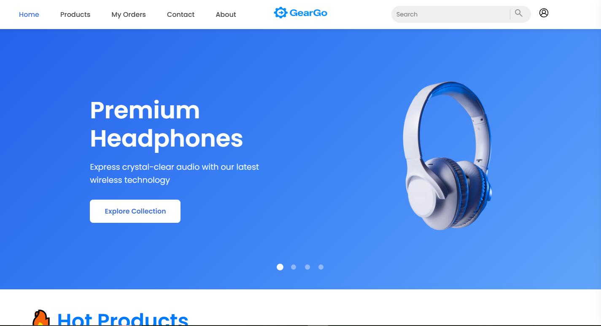
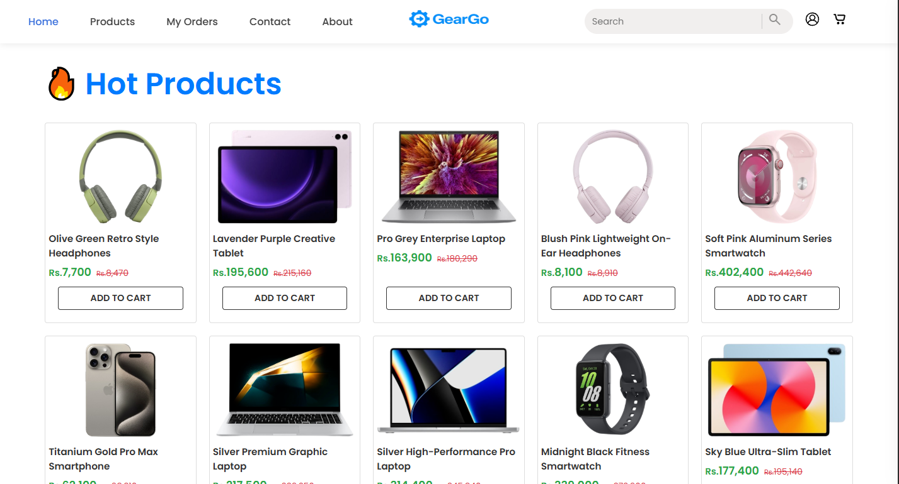
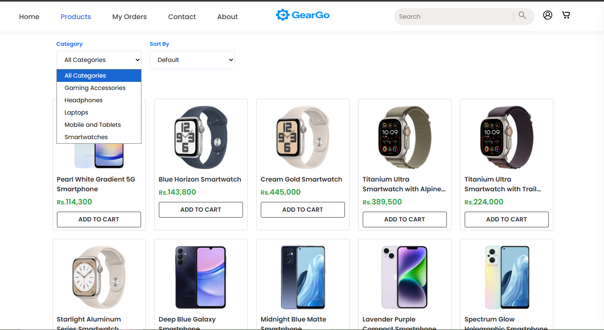
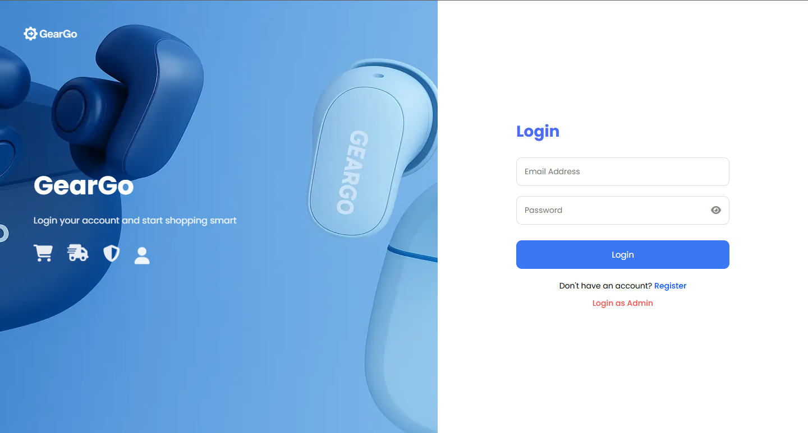
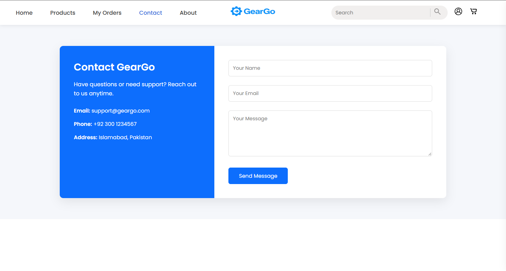
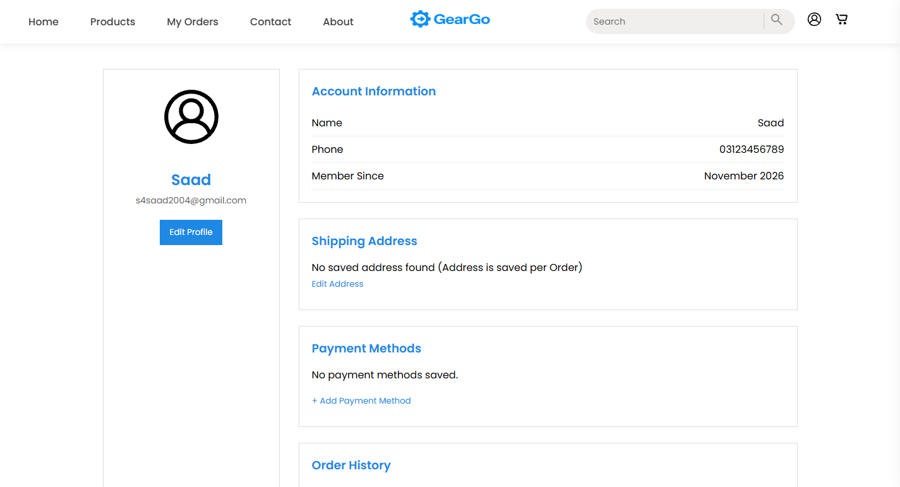
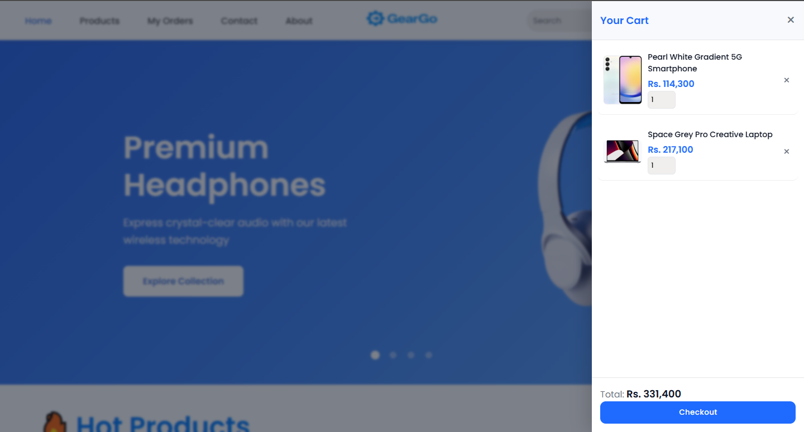
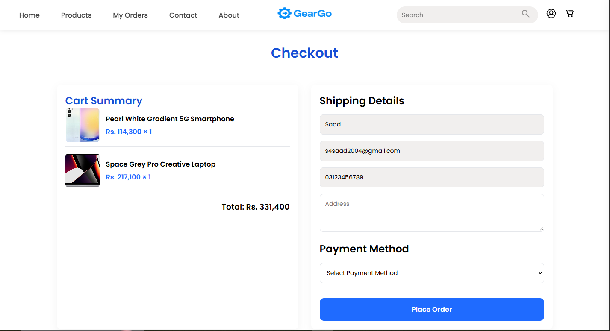
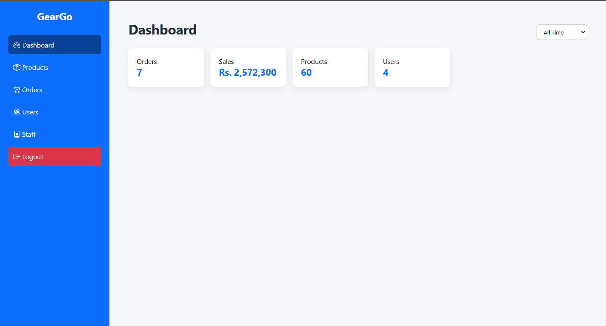
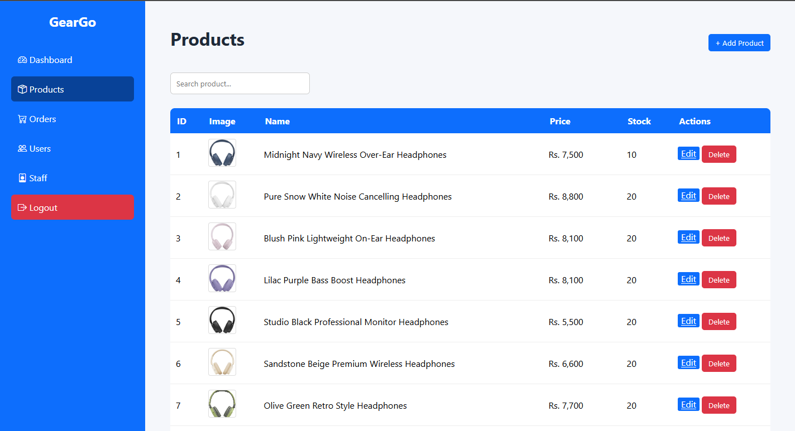

<div align="center">

# 🎧 GearGo

**A full-stack e-commerce storefront for premium tech accessories, built with PHP, MySQL and Docker.**

<p align="center">
  
  
  
  
  
  
  
  
  
  
</p>

</div>

---

## 📖 About

**GearGo** is an online store for tech gear: headphones, smart watches, laptops, mobiles and tablets. Customers can browse categories, search with live suggestions, manage a cart, check out and track their orders. Store owners get a dedicated admin area to manage the shop.

The whole stack (Apache + PHP, MySQL) is containerised, so you can have a working copy running with a single command.

## ✨ Features

### Storefront
- 🏠 **Home page** with an auto-rotating hero slider, "Hot Products" grid (random picks), promo banner and "Why buy from GearGo" section
- 🗂️ **Category browsing** (Headphones, Smart Watches, Laptops, Mobiles & Tablets and more)
- 🔍 **Search** with live AJAX suggestions on desktop and mobile
- 📦 **Product pages** with details and add-to-cart
- 🛒 **Slide-out cart sidebar** with quantity updates, item removal and a running total (prices in PKR)
- 💳 **Checkout flow** with server-side error feedback
- 📜 **Order history** ("My Orders") for logged-in users
- 👤 **User accounts**: registration, login, and a profile page with profile picture upload
- 📱 **Responsive design** with mobile menu, mobile search bar and device-specific banners
- ✉️ **Contact** and **About** pages

### Admin
- 🛠️ Admin area (`/admin`) for managing store content

### Engineering
- 🐳 One-command setup with Docker Compose
- 🗄️ Database schema auto-imported on first start
- 💾 Persistent volumes for the database and user uploads
- 🔒 Prepared statements (`mysqli`) for database queries and `htmlspecialchars` output escaping
- ⚙️ Configuration through environment variables

## 🧰 Tech Stack

| Layer      | Technology                                               |
|------------|----------------------------------------------------------|
| Frontend   | HTML5, CSS3, Vanilla JavaScript                          |
| Icons/Fonts| Bootstrap Icons, Material Symbols, Google Fonts (Poppins)|
| Backend    | PHP 8.3 (`mysqli`)                                       |
| Web server | Apache (`mod_rewrite` enabled)                           |
| Database   | MySQL 9.1                                                |
| DevOps     | Docker, Docker Compose                                   |

## 📁 Project Structure

```
Geargo/
├── Backend/                 # Config, helper functions, session manager, DB schema
│   ├── config/              # session_manager.php, functions.php (DB connection, cart & search helpers)
│   └── database_file/       # geargo.sql, auto-imported into MySQL on first run
├── Local docker files/      # Docker files for local development
├── Login/                   # Login pages
├── Register/                # Registration pages
├── about/                   # About page
├── admin/                   # Admin area
├── assets/                  # Images, logos, SVGs and user uploads
├── cart/                    # Cart logic (add, update quantity, remove) + cart.css / cart.js
├── category/                # Category and product listing
├── checkout/                # Checkout flow
├── components/              # Reusable PHP partials (e.g. disclaimer)
├── contact/                 # Contact page
├── orders/                  # Order history
├── product page/            # Single product view
├── search/                  # Search results
├── user profile/            # User profile page
├── .env (example)           # Example environment variables
├── Dockerfile               # PHP 8.3 + Apache image
├── docker-compose.yml       # Web + MySQL services
├── home.css / home.js       # Home page styles and behaviour
├── index.php                # Home page
└── uploads.ini              # PHP upload limits
```

## 🚀 Getting Started

### Prerequisites

- [Docker](https://docs.docker.com/get-docker/) and [Docker Compose](https://docs.docker.com/compose/install/)
- [Git](https://git-scm.com/)

### Installation

**1. Clone the repository**

```bash
git clone https://github.com/SaadLabs/Geargo.git
cd Geargo
```

**2. Create your environment file**

Copy the example file to `.env` and fill in your own values:

```bash
cp ".env (example)" .env
```

| Variable           | Description                                  |
|--------------------|----------------------------------------------|
| `DB_HOST`          | Database host (use `db`, the compose service name) |
| `DB_NAME`          | Name of the MySQL database                   |
| `DB_USER`          | MySQL application user                       |
| `DB_PASSWORD`      | Password for the application user            |
| `DB_ROOT_PASSWORD` | MySQL root password                          |

> ⚠️ Never commit your real `.env` file. Use strong, unique passwords.

**3. Build and start the containers**

```bash
docker compose up -d --build
```

**4. Open the app**

| Service | URL                       |
|---------|---------------------------|
| Website | http://localhost:8080     |
| MySQL   | `localhost:3306`          |

On the first start, MySQL automatically imports `Backend/database_file/geargo.sql` to create the schema and seed data.

> 💡 The SQL import only runs when the database volume is empty. To reset the database, run `docker compose down -v` and start again (this deletes all stored data).

### Useful commands

```bash
docker compose logs -f web     # Follow web server logs
docker compose logs -f db      # Follow database logs
docker compose restart         # Restart the stack
docker compose down            # Stop containers (data is kept)
docker compose down -v         # Stop containers and delete all data
```

## 🌐 Deployment

1. Provision a server with Docker and Docker Compose installed.
2. Clone the repo and create a production `.env` with strong passwords.
3. In `docker-compose.yml`, change the port mapping from `"8080:80"` to `"80:80"` if you are serving on a domain.
4. **Do not expose MySQL publicly.** Remove or restrict the `3306:3306` port mapping in production.
5. Run `docker compose up -d --build`.
6. Put a reverse proxy (Nginx, Caddy or Traefik) in front for HTTPS.

The `restart: always` policy keeps the site online after a server reboot, and the named volumes `db_data` and `uploads_data` keep your database and uploaded files safe across restarts and rebuilds.

## 🖼️ Uploads

User-uploaded files (such as profile pictures) are stored in `assets/uploads/`, backed by the `uploads_data` Docker volume. Upload size limits are configured in [`uploads.ini`](uploads.ini), which is mounted into the PHP container.

## 🗺️ Roadmap

- [ ] Online payment gateway integration
- [ ] Product reviews and ratings
- [ ] Wishlist
- [ ] Order status emails
- [ ] Coupon and discount codes

## 📄 License

No license has been specified for this project.

## 👤 Authors

**SaadLabs**
- GitHub: [@SaadLabs](https://github.com/SaadLabs)
**Khizar515**
- GitHub: [@Khizar515](https://github.com/Khizar515)


---

<div align="center">

⭐ If you like this project, please give it a star!

</div>